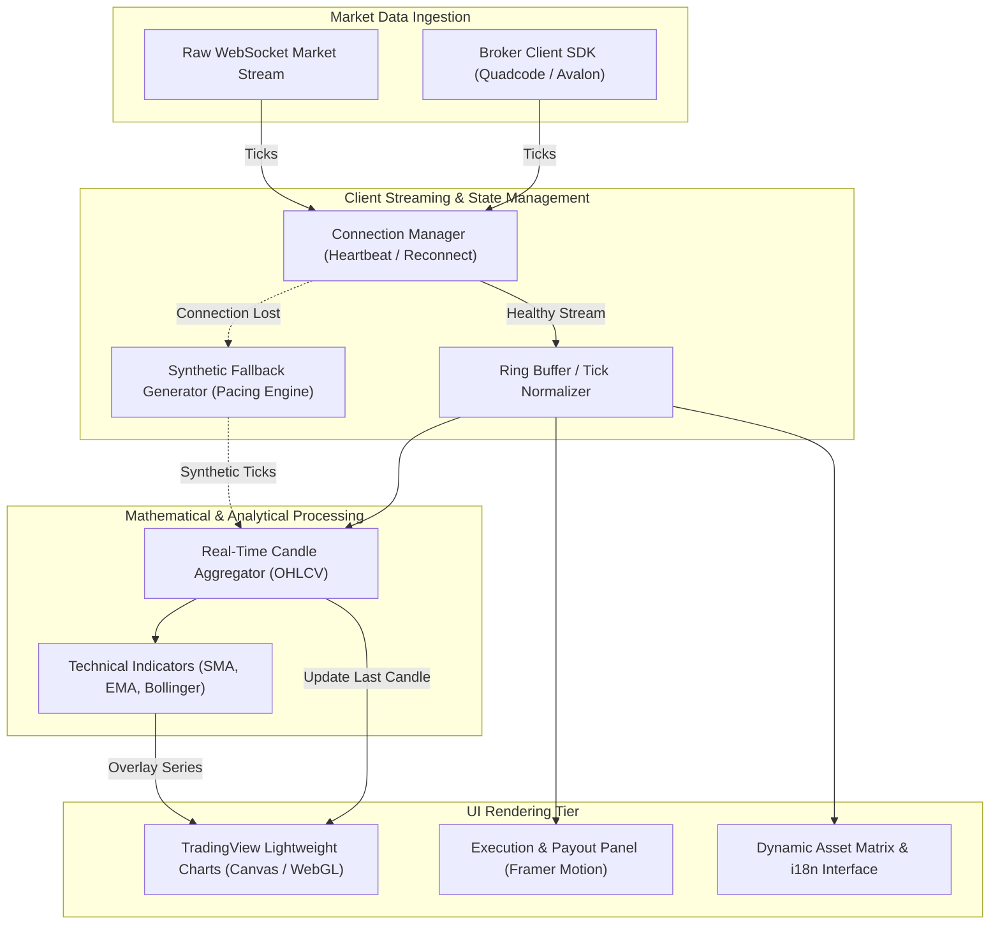

# BackOption — Real-Time Financial Trading Platform Architecture


> **Architectural case study of a responsive, event-driven binary options trading terminal featuring high-frequency WebSocket streams, TradingView Lightweight Charts, client-side technical indicators, and resilient offline candle synthesis.**

---

## 🔒 Private Source Notice

```
Production source code is proprietary and private due to commercial IP and broker SDK agreements.
This public repository contains sanitized architecture documentation, streaming pipeline patterns,
failover specifications, and technical trade-offs.
No proprietary broker credentials, private SDK binaries, or financial algorithms are published here.
```

---

## 1. Executive Summary

| Parameter | Specification |
|---|---|
| **System Type** | Real-Time Financial Trading Terminal & Market Analytics Platform |
| **Domain** | Binary Options, Synthetic Indices, and Real-Time Quote Visualization |
| **Live Production** | `backoption.io` |
| **Frontend Stack** | React 18, Vite 6, TailwindCSS, Framer Motion, TanStack Query |
| **Chart Engine** | Lightweight Charts (TradingView) supporting custom candle overlays |
| **Streaming Tier** | Persistent WebSockets (`ws` / Socket.IO) + Broker SDK Integration |
| **Analytics Engine** | Client-Side Mathematical Indicators (`technicalindicators`: SMA, EMA, Bollinger Bands) |

---

## 2. What I Built & Core Responsibilities

As a key frontend & streaming systems engineer on this platform, I designed and implemented:

1. **Persistent WebSocket Streaming Pipeline:** Architected real-time quote consumption with automatic reconnection backoff, heartbeat health monitoring, and graceful degradation.
2. **Interactive Charting Engine:** Integrated TradingView Lightweight Charts with support for sub-second to monthly timeframes (1s, 5s, 15s, 1m, 5m, 1h, 1d) and zero-lag DOM updates.
3. **Client-Side Technical Indicator Layer:** Integrated mathematical calculation engines for real-time overlays (Bollinger Bands, Exponential Moving Averages, RSI) dynamically recalculated on incoming tick events.
4. **Resilient Simulation / Fallback Mode:** Engineered a synthetic candle generator that maintains smooth chart animations and realistic price pacing during network interruptions or broker feed maintenance.
5. **Asset & Payout Management UI:** Created an intuitive asset selector with real-time payout percentages, search filtering, and internationalization (i18n).

---

## 3. High-Level Streaming Architecture



---

## 4. Engineering Deep Dives & Documentation

Detailed engineering breakdown documents are available in the [`docs/`](./docs) directory:

- [**Streaming Architecture & Tick Pipelines**](./docs/architecture.md) — Persistent WebSocket lifecycle, ring buffer aggregation, and state distribution.
- [**Technical Decisions & Trade-Offs**](./docs/technical-decisions.md) — TradingView Lightweight Charts vs Chart.js/Canvas, Vite vs Next.js, and client-side indicator calculation.
- [**Data Flow & Candle Lifecycle**](./docs/data-flow.md) — From raw market tick to animated chart update and indicator refresh.
- [**Reliability & Feed Failover**](./docs/security.md) — Connection recovery, synthetic pacing, and race-condition prevention.
- [**Testing & Performance Benchmarking**](./docs/testing.md) — High-frequency render profiling, memory leak prevention, and synthetic stream verification.

---

## 5. Technology Stack Verification

All technologies listed are verifiable directly in the production dependency trees:

| Domain | Technology | Production Package | Role |
|---|---|---|---|
| **Core Framework** | React 18 / Vite 6 | `react`, `react-dom`, `vite` | Ultra-fast client application bundler |
| **Chart Visualization** | Lightweight Charts 4.1 | `lightweight-charts` | High-performance canvas-based financial charts |
| **Financial Mathematics** | Technical Indicators 3.1 | `technicalindicators` | Pure mathematical calculation of SMA, EMA, BB |
| **Broker Integration** | Client SDK | `@quadcode-tech/client-sdk-js` | Trading protocol & broker gateway integration |
| **Streaming Transport** | Socket.IO Client / WS | `socket.io-client`, `ws` | Persistent bidirectional quote piping |
| **State & Data Fetching**| TanStack Query 5 | `@tanstack/react-query` | Server state cache and dynamic asset metadata |
| **Animation & UI** | TailwindCSS + Framer Motion | `tailwindcss`, `framer-motion` | 60 FPS transitions and responsive trading controls |
| **Form & Input Validation** | React Hook Form + Zod | `react-hook-form`, `zod` | Financial input parsing and order validation |

---

## 6. Key Learnings & Engineering Growth

1. **Garbage Collection Pressure in High-Frequency Streams:** Receiving 20–50 market ticks per second creates significant object allocation overhead. Reusing mutable tick buffers instead of creating new object instances on every tick eliminated micro-stutters in UI rendering.
2. **Decoupling Market Ingestion from Chart Painting:** Direct DOM/Canvas updates on every raw tick cause frame drops. Implementing an animation-frame throttle (`requestAnimationFrame`) to batch paint updates maintained a rock-solid 60 FPS under volatile market spikes.
3. **Synthetic Pacing for Smooth User Experience:** Network drops during paper-trading sessions disrupt user engagement. Building an algorithmic candle synthesis engine that gracefully resumes real market feeds without jump cuts was a major engineering breakthrough.

---

## 7. License & Credits

- Architectural documentation: **CC-BY-NC 4.0**
- Architect & Lead Implementer: **Leonardo Santana** ([@leonardosantana214](https://github.com/leonardosantana214))
- Live Platform: [backoption.io](https://backoption.io)
