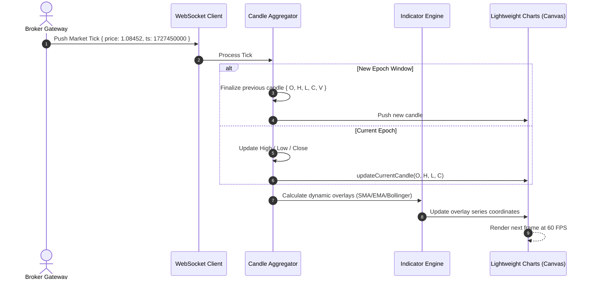

# BackOption Streaming Architecture Deep Dive

## 1. High-Frequency Market Ingestion Pipeline

The BackOption client application maintains a persistent bidirectional WebSocket connection to broker streaming endpoints. Because market data can surge during major macroeconomic announcements, the ingestion pipeline uses a **three-stage decoupling architecture**:

```
[WebSocket Network Stream]
           │ (raw tick bytes)
           ▼
[Connection & Heartbeat Manager]
           │ (validated price/timestamp packet)
           ▼
[Ring Buffer & Throttler]
           │ (batched state on requestAnimationFrame)
           ▼
[TradingView Canvas Chart & UI Components]
```

## 2. Dynamic Candle Aggregation (OHLCV)

Raw market ticks (`{ price, timestamp, volume }`) are aggregated client-side into Candlestick (OHLCV) records according to the selected timeframe:
- **Open:** Price of the first tick within the epoch window.
- **High:** Maximum price observed within the epoch window.
- **Low:** Minimum price observed within the epoch window.
- **Close:** Most recent price tick observed.
- **Volume:** Cumulative volume across the epoch.



## 3. Resilient Offline Pacing & Synthetic Mode

When network connectivity degrades:
1. The `ConnectionManager` detects heartbeat timeout (missed 3 consecutive 2-second pings).
2. It transitions the terminal state to `FALLBACK_PACING`.
3. A client-side synthetic tick generator activates, producing low-volatility geometric Brownian motion ticks anchored to the last verified market price.
4. When reconnection succeeds, incoming authoritative ticks smoothly reconcile the chart timeline without causing visual jumps or desynchronization.
