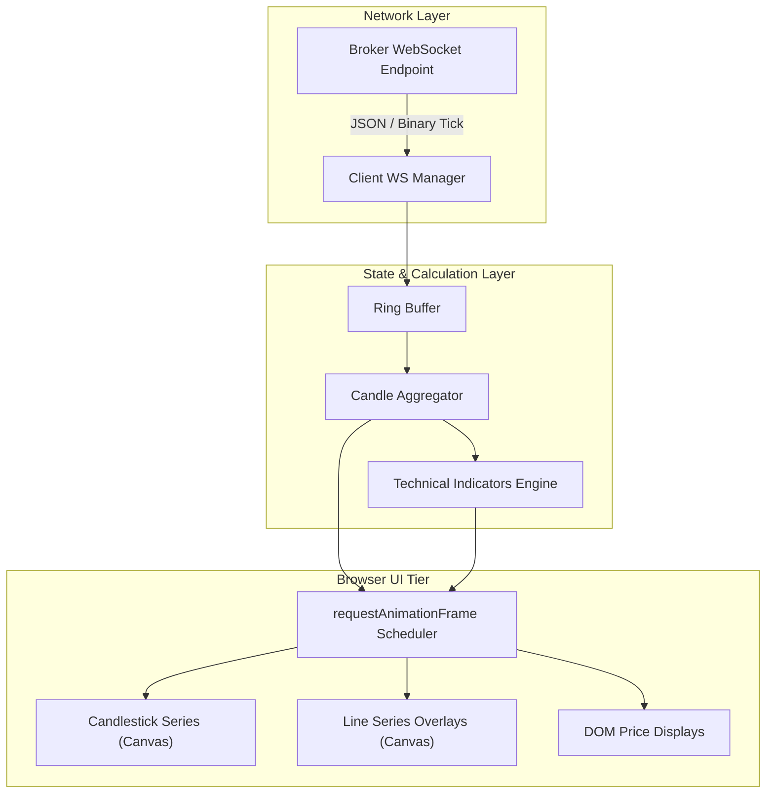

# Data Flow & Indicator Lifecycle — BackOption

## 1. Tick Ingestion to Canvas Paint Flow

## 2. Multi-Timeframe Switching Lifecycle

When a user switches from 1-minute to 1-hour candles:
1. Active candlestick series is preserved while a background fetch retrieves historical batch OHLCV data.
2. Lightweight Charts replaces historical coordinate buffers in a single pass.
3. The WebSocket pipeline reconfigures the client aggregator to group subsequent live ticks according to the new 3600-second epoch boundary.
4. Indicators recompute over the new timeframe data without UI lag.
